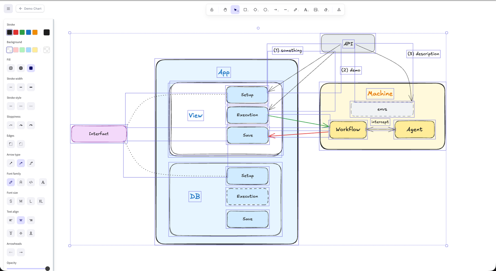
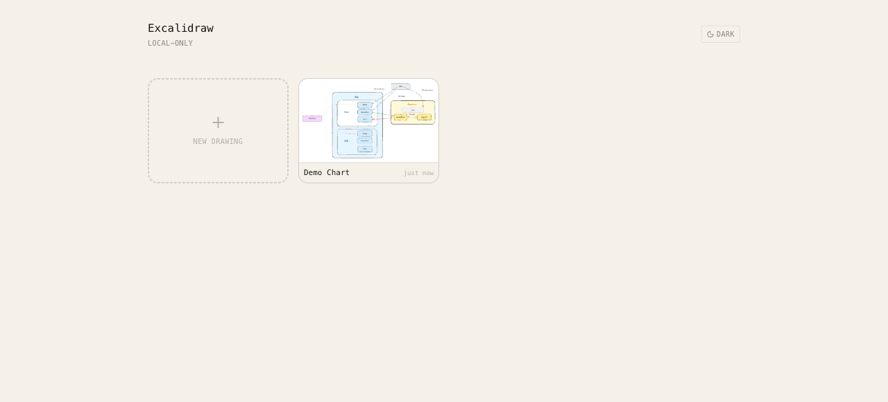

# excalidraw-standalone

A single-page Excalidraw notebook with a multi-drawing list view and
auto-save. Runs entirely in the browser by default; flip one env var to
turn on Convex sync for cross-device drawings.

[](https://vercel.com/new/clone?repository-url=https%3A%2F%2Fgithub.com%2Fseonglae%2Fexcalidraw-standalone) [](https://docs.convex.dev/quickstart/react)





## Features

- Multi-drawing list view with thumbnails, rename, delete
- Excalidraw editor with the full upstream toolbar (PNG/SVG export, libraries, etc.)
- 500 ms debounced auto-save on every edit
- Light / dark theme toggle that follows your system by default
- Local-only mode (zero infra) **or** Convex sync mode via one env var
- Short URLs (`?d=<id>`) — every drawing is a deep link

## Quick start

### Local-only mode (no backend)

```bash
git clone https://github.com/seonglae/excalidraw-standalone.git
cd excalidraw-standalone
pnpm install
pnpm dev
```

Drawings live in `localStorage` under the key `excalidraw-standalone.drawings.v1`.
Per-browser, no sync. Open `http://localhost:5174`.

### Convex sync mode (cross-device)

```bash
pnpm install
pnpm dlx convex dev   # creates a free Convex project, prints VITE_CONVEX_URL
cp .env.example .env.local
# paste the VITE_CONVEX_URL into .env.local
pnpm dev
```

Now the same drawings show up on every browser pointed at the same Convex
deployment. Run a separate Convex deployment per person for isolated workspaces.

## Deploy

```bash
pnpm build
```

The build is a static SPA. Drop the `dist/` folder on any static host
(Vercel, Netlify, GitHub Pages, S3+CloudFront, your own nginx).

The included `vercel.json` rewrites all routes to `/` so `?d=<id>`
deep-links survive a page refresh.

For Vercel deployment with Convex sync, set `VITE_CONVEX_URL` in the
project's environment variables.

### Access control

Two paths, pick whichever fits.

**Vercel Deployment Protection** — gates the URL with a single toggle.

1. Vercel project → **Settings → Deployment Protection**
2. Choose one:
   - **Standard Protection** — Vercel SSO; only your team members get in
   - **Password Protection** — one shared password challenges every visitor
3. Save. Vercel handles the challenge before any request hits the app.

Standard and Password Protection apply to Production on the Pro plan.
On Hobby they cover Preview URLs.

**Clerk sign-in (per-user drawings)** — enables a real auth layer with
each user's drawings scoped to them on Convex.

1. Create a Clerk project at https://clerk.com. In Clerk dashboard
   → **JWT Templates → New → Convex** (the template name must be `convex`).
2. Set the frontend env var:
   ```bash
   echo "VITE_CLERK_PUBLISHABLE_KEY=pk_live_..." >> .env.local
   ```
3. Tell the Convex deployment about Clerk:
   ```bash
   pnpm dlx convex env set CLERK_ISSUER_URL https://your-app.clerk.accounts.dev
   ```
4. `pnpm dev` — the app shows a sign-in screen, and Convex scopes every
   drawing by `ownerId = <Clerk user>`.

Leaving either env var blank keeps that layer off. With both env vars set
and Convex configured, anonymous requests are rejected.

## URL scheme

| URL | Shows |
|---|---|
| `/` | drawings list |
| `/?d=<id>` | editor for drawing `<id>` |

Back / forward browser buttons work as expected.

## Repo layout

```
excalidraw-standalone/
├── src/
│   ├── main.tsx              # entry, picks Convex/local provider
│   ├── App.tsx               # routes: list vs editor
│   ├── DrawingsView.tsx      # thumbnail grid
│   ├── DrawingEditor.tsx     # Excalidraw mount + debounced save
│   ├── ThemeToggle.tsx       # light / dark switch
│   ├── index.css             # tailwind v4 + theme tokens
│   └── storage/
│       ├── types.ts          # DrawingStore interface
│       ├── local.ts          # localStorage adapter
│       ├── convex.ts         # Convex adapter
│       └── index.ts          # picks one at build time via VITE_CONVEX_URL
└── convex/
    ├── schema.ts             # single drawings table
    └── drawings.ts           # list / getById / create / update / rename / remove
```

## License

MIT — see [LICENSE](./LICENSE).

Extracted from [letter-automation](https://github.com/seonglae/letter-automation).
